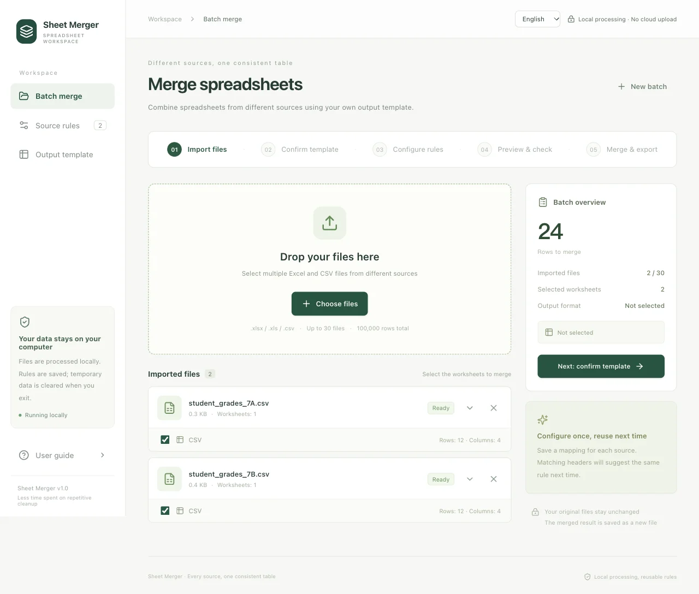
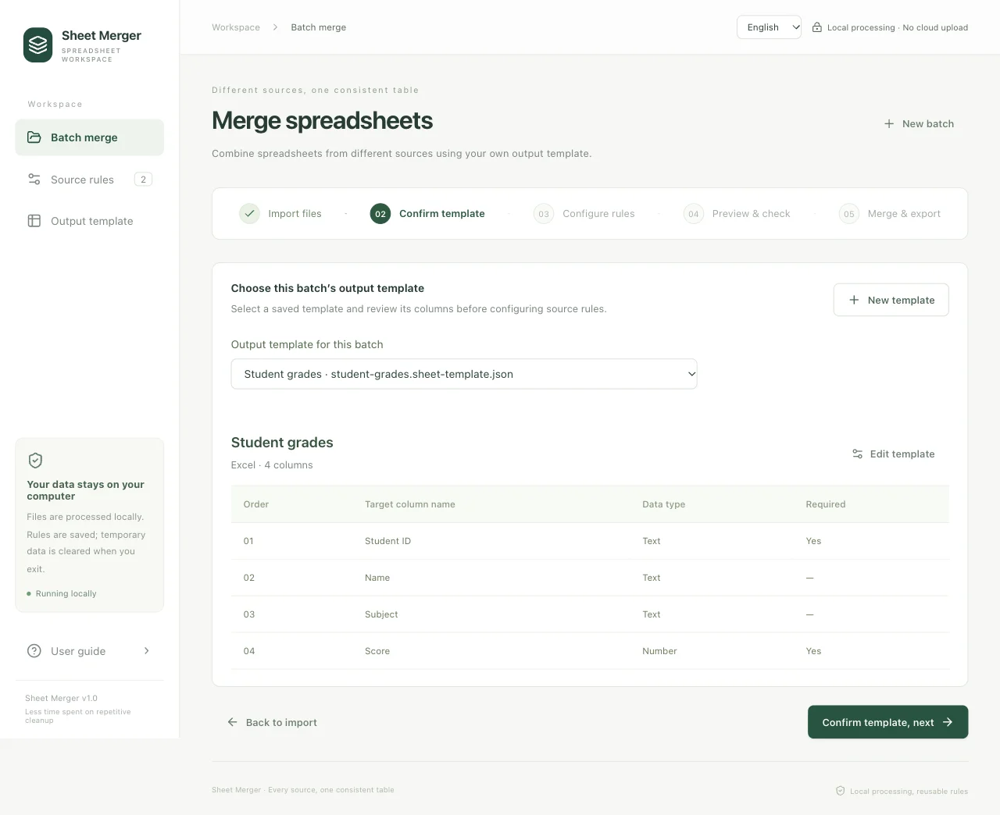
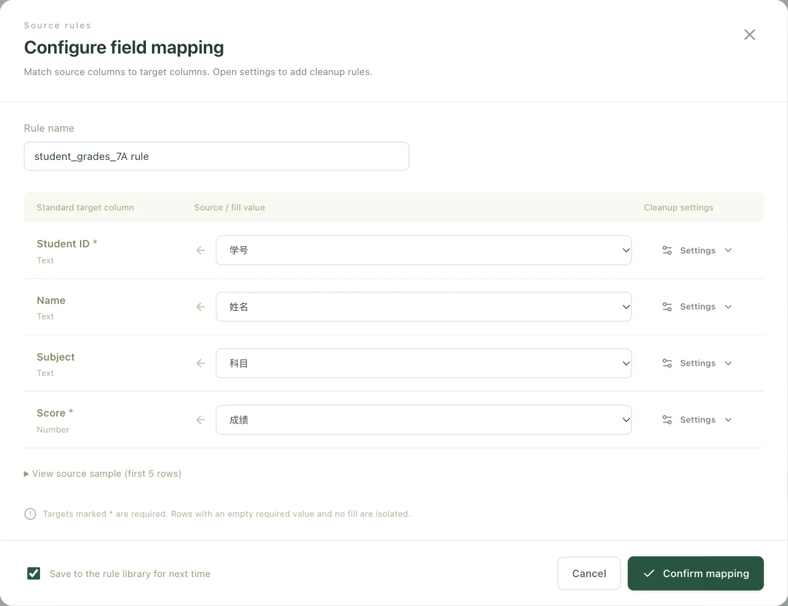
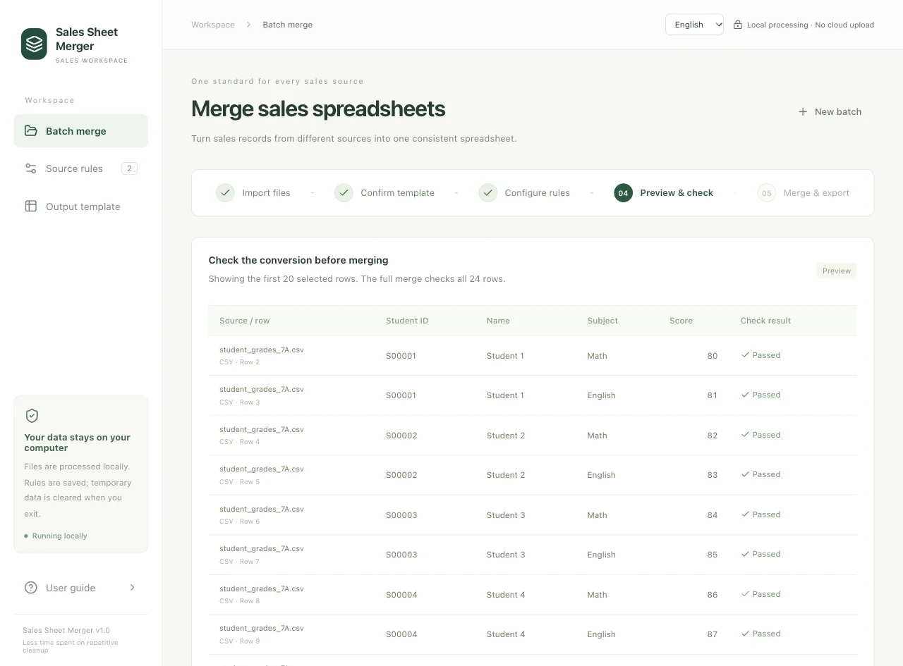
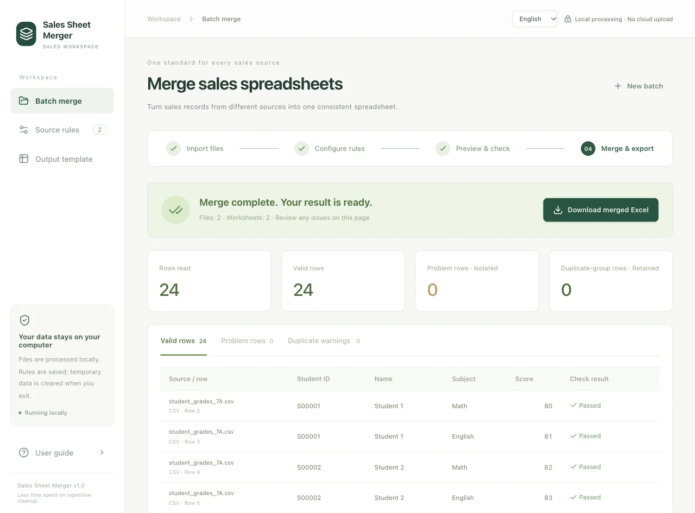
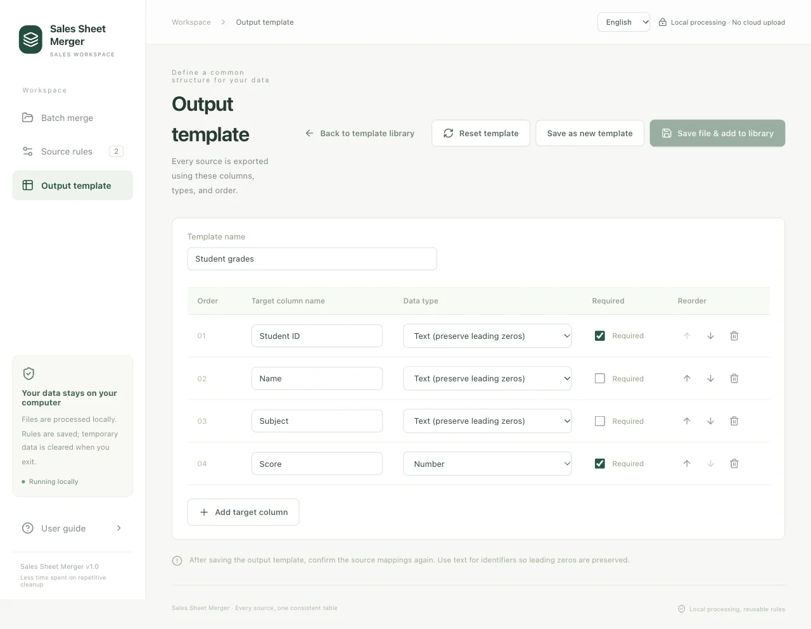

# Sheet Merger

[English](README.md) · [简体中文](README.zh-CN.md)

Merge spreadsheets with different column names into one consistent Excel file. Define your output columns once, save a mapping for each source, and reuse it next time.

Use it for student grades, inventory lists, order records, or any tables that need a consistent column layout. Spreadsheets are parsed and merged in your browser and are not uploaded to the application server. No account, API key, or separate database service is required.

- **Import:** `.xlsx`, `.xls`, and `.csv`, including multiple worksheets.
- **Customize:** output column names, order, data types, and required fields.
- **Reuse:** save field mappings and cleanup settings; back up the configuration as JSON.
- **Export:** one `.xlsx` worksheet containing valid merged records.
- **Languages:** English by default, with a Simplified Chinese switch.

[Get started](#get-started) · [Deploy on Render](#deploy-on-render) · [User guide](#user-guide) · [Common questions](#common-questions) · [Development](#development)

## Get started

The included setup and launcher scripts are for **macOS**. Install **Node.js 22.18+ with npm** first, then download or clone this repository and open a terminal in the project directory:

```sh
./setup.sh
./start.command
```

After setup, you can also double-click `start.command`. It opens <http://127.0.0.1:4173> in your browser. If dependencies or the frontend build are missing, the launcher runs setup automatically. Installation requires internet access; once the page has loaded, spreadsheet processing works without a network connection.

Keep the launch terminal open while using the local preview. **Closing the browser does not stop it.** You can stop it with **Control-C**; stopping the preview does not remove templates, rules, or the last saved batch from this browser. Use **Clear browser data** in the app when you want to remove that local data.

## Deploy on Render

The repository includes a [Render Blueprint](render.yaml) for deploying the app as a static site. The build does not require Python, a start command, a persistent disk, a database, or environment variables.

In the Render Dashboard, choose **New → Blueprint**, connect this repository, and apply the detected `render.yaml`. Render will use:

| Setting | Value |
| --- | --- |
| Runtime | Static |
| Build command | `npm --prefix frontend ci && npm --prefix frontend run build` |
| Publish directory | `frontend/dist` |

Render serves the application files from its CDN. Source spreadsheets stay in the browser and are not sent to Render; the deployed Content Security Policy also blocks network connections from the loaded app. Templates and rules are stored separately by browser and site address, so an `onrender.com` domain and a later custom domain do not share the same browser data. Export the rule library before changing domains if you need to move it.

The app also works in current Android Chrome or Edge. Files can be selected from the Android file picker, and merged Excel workbooks are downloaded normally. Complex template editing is easier on a tablet or desktop.

## User guide

This example combines two student-grade tables with different headers: **12 records per file → 24 merged records**. The same steps apply to other spreadsheets. Screenshots use fictional data; click an image to view it at full size.

Two settings work together:

| Setting | What it decides |
| --- | --- |
| **Output template** | Which columns appear in the final file, in what order and with which data types. |
| **Source rules** | Which column in each original file supplies each output column. |

### 1. Import your files

Drag files into **Batch merge**, or click **Choose files**. Select the worksheets you want to combine, then click **Next: configure rules**.

Expand a file to preview the source data. If its column names are not on the first row, change **Header row**.



### 2. Select and confirm an output template

Every new batch starts with no template selected. Entering this step shows the template list directly. If you click **Confirm template, next** without selecting a template, the **No output template selected** prompt appears. Click **Select template** to return to the current list, or **New template** to open a blank template form directly.

Choose **Student grades** and review its four columns: **Student ID**, **Name**, **Subject** (Text), and **Score** (Number). Click **Confirm template, next**.

If you have no saved templates, see [Create and edit templates](#create-and-edit-templates) below. Imported files and worksheet selections stay in place while you configure a template.



### 3. Match the source columns

Click **Configure & confirm** for each source. For every output column on the left, select the corresponding source column on the right:

| Output column | First file | Second file |
| --- | --- | --- |
| Student ID | 学号 | Student ID |
| Name | 姓名 | Student Name |
| Subject | 科目 | Subject |
| Score | 成绩 | Points |

Keep **Save to the rule library for next time** checked if you want to reuse the mapping, then click **Confirm mapping**. Confirm every selected source before continuing.



### 4. Preview and check

Click **Preview converted data**. Check the IDs, names, scores, and warnings in the first 20 records. Return to the source rules to correct a mapping. To change the output template, return to step 2; mappings must be confirmed again after a change.



### 5. Merge and download

Click **Start merge** → **Download merged Excel**. This example produces **24 valid records** with the same four columns.

The downloaded Excel contains **one worksheet of valid records**. Problem rows and their reasons stay on the results page. Exact duplicates are retained and flagged; they are not automatically removed.



## Create and edit templates

Open **Output template** to access the template library. Click **New template**, or **Edit template** beside a saved entry. Enter a name, add or reorder columns, and set each column’s type and required status. Gray examples are placeholders, not saved values.

Click **Save file & add to library** to choose a folder and filename on your computer. The JSON file contains the template configuration, without table data or source rules. After the file is saved, the template is added to the library automatically. Editing updates that library entry; **Save as new template** creates a separate entry.

Desktop Chrome and Edge can open the native save-location dialog. Other browsers, including browsers on Android, download the template JSON through the normal download flow. Cancelling or failing to write the file leaves the library unchanged. If a file chosen through the native dialog is saved but registration fails, retry adding it to the library without writing it again.

**Import template JSON** adds an existing template file to the library. A changed file with the same template ID requires confirmation before replacing the library copy. External file edits are not synchronized automatically; reimport the file to apply them. The tool does not delete or silently rewrite your saved files.



Use **Delete** to the right of **Edit template** to remove a library entry after confirmation. Its saved JSON file, imported files, and source rules are kept. If it was selected for the current batch, select another template before continuing.

## Reuse your setup

Your template library and saved source rules remain available after restarting. Select a template explicitly for each new batch. On your next import, matching headers suggest a saved rule—even when their column order differs. Review and confirm the mapping before merging.

Use **Source rules → Export rule library** to back up the current output template, template library, and saved source rules as JSON. **Import rule library** restores a backup by replacing the current template, template library, and rules.

To change the final columns, edit **Output template** and save, then confirm the source mappings again. **Reset template** clears the current template configuration and draft after confirmation; saved templates, imported files, and source rules remain available.

## Common questions

**Can this merge more than two files?**

Yes. Each batch supports up to **30 files and 100,000 selected data rows**, with a **50 MB limit per file**. You can select several worksheets from a file.

**Chinese CSV text looks wrong. What should I do?**

Expand the imported file and try **GB18030** under **Character encoding**. UTF-8 CSV files use the default setting.

**How do I keep leading zeros in IDs?**

Use the **Text** output type. Existing text zeros and simple formats such as `000000` are preserved; digits already lost in the source cannot be recovered.

**Why are some rows missing from the download?**

Entirely blank rows are skipped. Empty required values or failed conversions become problem rows; inspect their original values and reasons on the results page.

**Does the tool calculate formulas or combine matching IDs?**

Formulas are not recalculated; save their calculated results in Excel before importing. This tool appends records into a common column layout. It does not join records by ID, aggregate totals into new rows, or automatically calculate amounts.

**How do I switch languages?**

Choose **English / 简体中文** in the top bar. The browser remembers your choice, and the in-app guide switches its screenshots too. Template names, source headers, and data remain as entered. The exported worksheet name uses the language selected when the merge starts.

## Data and conversion details

Files are processed in the browser. Source files are never overwritten and spreadsheet contents are not uploaded to the application server. The template library, source rules, imported files, processing rows, and the last workspace are stored in this browser's IndexedDB for the current site address. This data is not synchronized between browsers or devices and can be removed by clearing site data, uninstalling the browser profile, or browser storage cleanup. Use **Source rules → Export rule library** to back up templates and rules. Downloaded files remain wherever your browser saves them.

<details>
<summary>Conversion behavior and additional limits</summary>

- Cleanup order: trim whitespace → fill empty values → replace exact whole-cell values (first match) → convert types.
- Dates follow the format selected in the rule; native Excel dates are read directly. Day/month order is not guessed. Number formats include `1,234.56`, `1234.56`, and `1.234,56`.
- Numbers use Decimal arithmetic, with up to 15 significant digits, 12 decimal places, and absolute value 10¹⁵. Values outside these limits become problems instead of being silently rounded. Currency and units are not converted.
- In `.xlsx`, a mapped formula without a saved result becomes a problem. The `.xls` reader exposes saved results only; unavailable results may appear empty and follow the usual fill/required-value rules.
- Text is exported as text, including values starting with `=`. Excessive text length and unsupported control characters are isolated.
- Exact duplicates are identified using all converted target values. Numeric `1.0` and `1.00` are equivalent; matching IDs alone do not imply duplicates.
- Additional limits: 1,000 source columns, 200,000 physical rows per worksheet, and 256 MB of uncompressed `.xlsx` content. One merge runs at a time. Complex merged-cell layouts are not supported.
- The deployed app allows only same-origin resources; its Content Security Policy blocks app network connections and no remote fonts, scripts, or analytics are loaded.

</details>

The template-file format identifiers are retained for compatibility with earlier versions; saved customer templates and rules are not renamed.

## Development

The active web app uses **React**, **TypeScript**, and **Vite**. Spreadsheet parsing, conversion, merging, and export run in a browser Web Worker, with IndexedDB storing browser data. Frontend dependencies are pinned in `frontend/package-lock.json`.

After installing frontend dependencies, start the development server:

```sh
npm --prefix frontend ci
npm --prefix frontend run dev
```

Vite serves the development app at <http://127.0.0.1:5173>. The current frontend does not call an API; Render serves the production build directly from `frontend/dist`.

The `backend/` directory contains the earlier FastAPI implementation, retained for compatibility checks and local reference. It is not used by the browser app or by the Render deployment. Its Python dependencies are locked in `requirements.lock`.

Run checks from the project directory. Frontend tests require Node.js 22.18+:

```sh
npm --prefix frontend run build
npm --prefix frontend run format:check
npm --prefix frontend test
npm --prefix frontend run test:browser -- --project=chromium
```

Install the Playwright Chromium browser first if needed:

```sh
npm --prefix frontend exec playwright install chromium
```

When changing the retained backend, also run:

```sh
.venv/bin/python -m pytest -q -s
```

Shared English and Chinese messages live in `shared/locales/`. Keep message keys and interpolation placeholders consistent between both catalogs. See [VALIDATION.md](VALIDATION.md) for test coverage and practical limitations.
