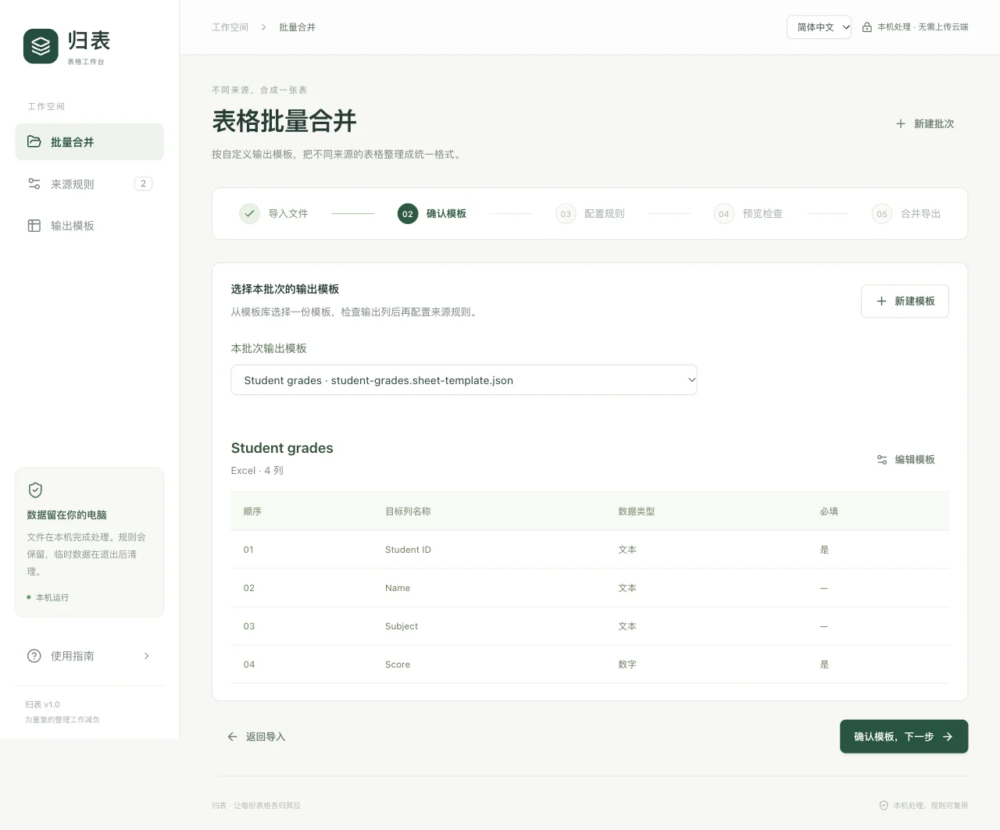
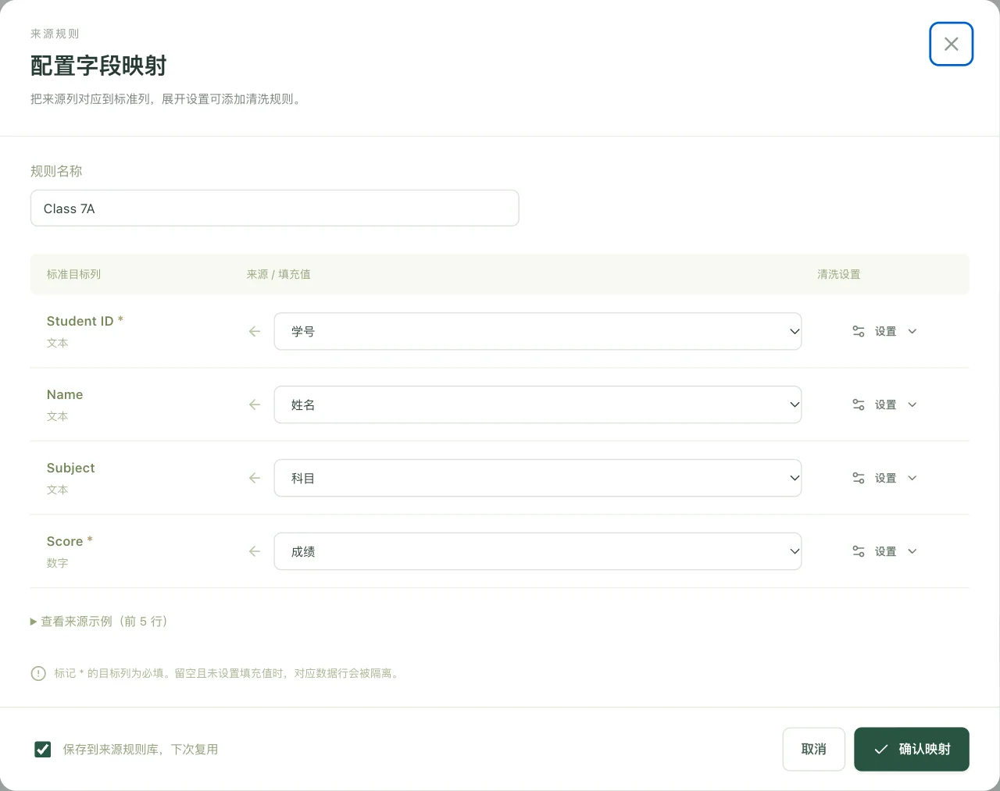
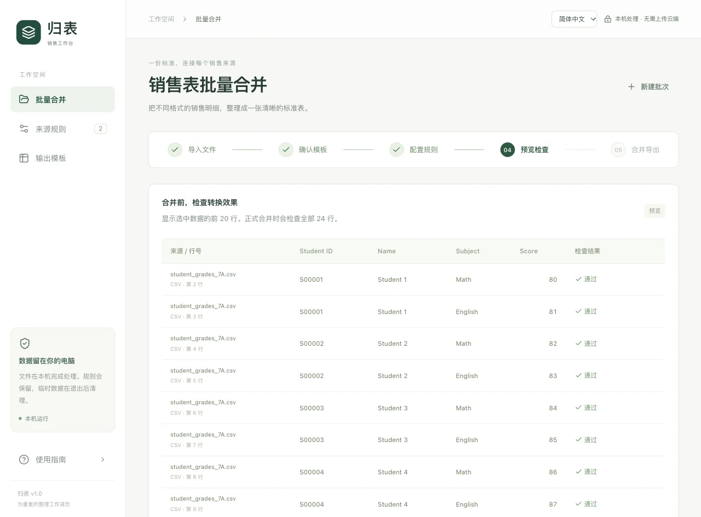
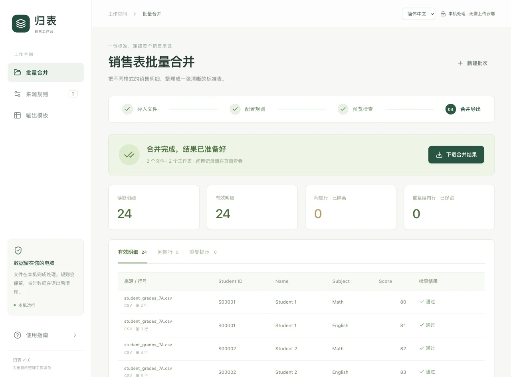
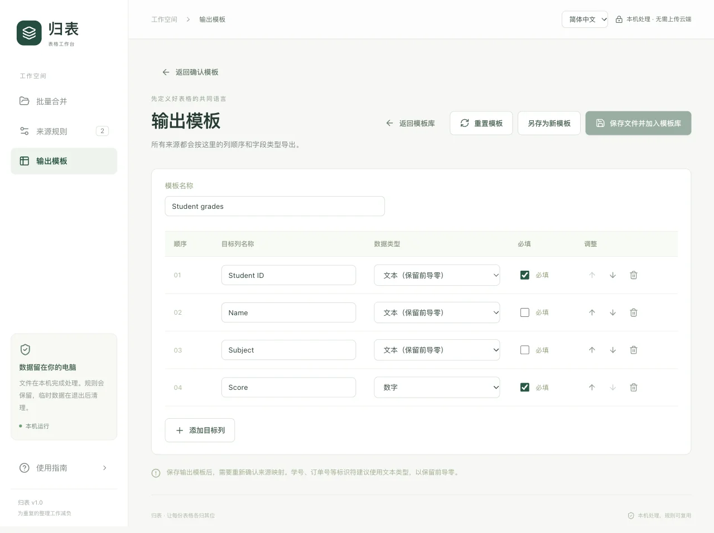

# 归表 · 表格批量合并工具

[English](README.md) · [简体中文](README.zh-CN.md)

把列名、列顺序不同的表格整理成一份统一的 Excel。自己定义输出列，为不同来源保存对应规则，下次直接复用。

适用于学生成绩、库存清单、订单明细等需要统一列格式的表格。文件在本机处理，无需账号或上传云端，也不需要 API Key 或单独安装数据库服务。

- **导入**：支持 `.xlsx`、`.xls`、`.csv`，可选择多个工作表。
- **自定义**：设置输出列名、顺序、数据类型和必填项。
- **复用**：保存来源映射和清洗设置，支持 JSON 配置备份。
- **导出**：生成只含有效合并记录的单工作表 `.xlsx` 文件。
- **语言**：默认英文，可切换简体中文。

[安装启动](#安装启动) · [使用指南](#使用指南) · [常见问题](#常见问题) · [开发](#开发)

## 安装启动

项目附带的安装和启动脚本适用于 **macOS**。先安装 **Python 3.11+**、**Node.js 20.19+ 和 npm**，下载或克隆仓库，然后在项目目录打开终端：

```sh
./setup.sh
./start.command
```

安装后也可以双击 `start.command`，浏览器会打开 <http://127.0.0.1:8765>。首次启动缺少依赖或前端构建时，启动器会自动执行安装。安装依赖需要联网，日常处理可离线使用。

使用时保持启动终端打开。**关闭网页不会停止后台。** 请先下载结果，再在终端按 **Control-C** 停止服务：本次导入和临时结果会清理，已保存的模板与规则会保留。

## 使用指南

下面用两份表头不同的学生成绩表演示：**每份 12 条 → 合并后 24 条**。其他表格也按同样步骤操作。截图中的数据为虚构示例，点击图片可查看大图。

先分清两个设置：

| 设置 | 作用 |
| --- | --- |
| **输出模板** | 决定最终有哪些列，以及列的顺序和数据类型。 |
| **来源规则** | 决定每个输出列从原表的哪一列取数据。 |

### 1. 导入需要合并的文件

在“批量合并”中拖入文件，或点击**选择文件**。勾选需要合并的工作表，再点**下一步：配置规则**。

展开文件可以查看原始数据。如果列名不在第一行，把**表头行**改成列名所在的行。


### 2. 选择并确认输出模板

每个新批次都不默认选择模板，进入这一步直接显示选择列表。只有未选择模板就点击**确认模板，下一步**时，才会显示**还未选择输出模板**。点击**选择模板**回到当前列表选择，或点击**新建模板**直接打开空白模板表单。

选择 **Student grades**，检查四个输出列：**Student ID、Name、Subject** 为文本，**Score** 为数字，再点**确认模板，下一步**。

还没有保存的模板时，按下方[新建和编辑模板](#新建和编辑模板)操作。配置期间，已导入文件和工作表选择会保留。



### 3. 把原表的列对应起来

为每份来源点击**配置并确认**。左侧是输出列，右侧选择原表中对应的来源列：

| 输出列 | 第一份表 | 第二份表 |
| --- | --- | --- |
| Student ID | 学号 | Student ID |
| Name | 姓名 | Student Name |
| Subject | 科目 | Subject |
| Score | 成绩 | Points |

需要下次复用时，保持勾选**保存到来源规则库，下次复用**，再点**确认映射**。所有选中的来源都确认后，才能继续。



### 4. 预览并检查

点击**预览转换结果**，检查前 20 条记录的学号、姓名、分数及提示。对应不正确时，可以返回调整来源规则；需要更换输出模板时，回到第二步，更换后重新确认映射。



### 5. 合并并下载结果

点击**开始合并** → **下载合并结果**。本例两份表统一为相同的四列，共 **24 条有效记录**。

下载的 Excel **只有有效明细一个工作表**。问题行及原因在结果页面查看；完全重复的记录会保留并提示，不会自动删除。



## 新建和编辑模板

在**输出模板**中打开模板库，点击**新建模板**，或在已有模板旁点击**编辑模板**。填写名称、增删或调整列顺序，再设置数据类型与必填项。灰色例字只是提示，需要自己填写。

点击**保存文件并加入模板库**，选择电脑上的文件夹和文件名。JSON 文件只包含模板配置，不包含表格数据和来源规则。文件保存成功后，模板会自动加入库中；编辑保存会更新原来的库中模板，**另存为新模板**则新建一份独立记录。

选择保存位置请使用 Chrome 或 Edge。不支持保存对话框的浏览器会显示提示，不会静默改存其他位置。取消或文件写入失败时，模板库不变；文件已保存但登记失败时，可以直接重试加入模板库，无需重新写文件。

**导入模板 JSON**可以把已有模板文件加入库中。相同模板 ID 的内容有变化时，确认后才替换库中配置。外部修改的文件不会自动同步，需要重新导入；工具不会删除或静默改写已保存的文件。



点击**编辑模板**右边的**删除**，确认后移除库中记录，电脑上的 JSON 文件、已导入文件和来源规则会保留。如果删除的是本批次选中的模板，需要重新选择后才能继续。

## 下次如何复用

重启工具后，模板库和已保存的来源规则仍然可用，每个新批次需要手动选择模板。再次导入相同表头的文件，工具会建议已有规则，列顺序不同也能匹配；检查并确认映射后再合并。

在**来源规则 → 导出规则库**中，可将当前输出模板、模板库和来源规则一起备份为 JSON。**导入规则库**会用备份替换当前模板、模板库和规则。

需要修改最终输出列时，到**输出模板**中编辑并保存，再重新确认来源映射。**重置模板**经确认后清空模板配置，模板库、已导入的文件和来源规则会保留。

## 常见问题

**只能合并两份表吗？**

不是。每批最多 **30 个文件、合计 10 万数据行**，单文件最多 **50 MB**。同一文件也可以勾选多个工作表。

**中文 CSV 乱码怎么办？**

展开文件，在**字符编码**中尝试选择 **GB18030**。UTF-8 CSV 使用默认设置即可。

**怎样保留学号、订单号前面的零？**

输出列选择**文本**类型。工具会保留已有文本前导零和 `000000` 这类简单补零格式；源文件已经丢失的位数无法恢复。

**为什么下载结果少了几行？**

全空行会跳过。必填为空或转换失败的记录会进入问题行，可在结果页面查看原始值和原因。

**会自动计算公式，或按学号、订单号合并同一条记录吗？**

不会重算公式，请先在 Excel 中计算并保存结果。工具将明细逐行追加到统一列格式中，不按编号关联记录、不汇总成新行，也不自动计算金额。

**怎么切换中英文？**

在顶部选择 **English / 简体中文**，浏览器会记住选择，应用内指南也会切换相应截图。模板名、来源表头和数据保持原样。导出工作表名使用开始合并时选定的语言。

## 数据与转换说明

文件在本机处理，原始文件不会被覆盖。配置保存在 `~/Library/Application Support/SalesSheetMerger/library.json`；导入批次、中间结果和生成的导出文件属于临时数据。处理结果使用本机临时 SQLite 文件，停止服务或下次启动时会清理，这些文件不会提交到仓库。已下载的文件保留在你选择的位置。应用内切换页面会保留当前批次；刷新网页或停止后台前，请先下载需要的结果。

<details>
<summary>转换规则与其他限制</summary>

- 清洗顺序：去除首尾空格 → 空值填充 → 精确值替换（第一条匹配）→ 类型转换。
- 日期按规则指定的格式转换，Excel 原生日期直接读取，不猜测月、日顺序。数字格式支持 `1,234.56`、`1234.56`、`1.234,56`。
- 数字使用 Decimal 处理，最多 15 位有效数字、12 位小数、绝对值不超过 10¹⁵。超限进入问题行，避免静默舍入；不自动换算币种或单位。
- `.xlsx` 映射列的公式缺少已保存结果时，记录进入问题行。`.xls` 读取器只提供已保存结果，缺失结果可能表现为空值，按空值填充和必填规则处理。
- 文本按文本类型导出，即使以 `=` 开头也不会变成公式。过长文本和不支持的控制字符会被隔离。
- 重复检查基于所有转换后的目标列。数字 `1.0` 与 `1.00` 等价；编号相同不代表整条记录重复。
- 其他限制：每表最多 1,000 列、200,000 物理行，`.xlsx` 解压后最多 256 MB。每次运行一个合并任务，不支持复杂合并单元格布局。
- 服务只监听 `127.0.0.1`，校验本机 Host 与请求 Origin，不加载远程字体、脚本或统计服务。

</details>

为兼容旧版本，本机数据目录与模板文件的格式标识保留原值；用户已保存的模板和规则不会被自动改名。

## 开发

后端使用 **FastAPI、openpyxl、xlrd**，前端使用 **React、TypeScript、Vite**。依赖通过 `requirements.lock` 和 `frontend/package-lock.json` 固定。

完成安装后，在两个终端分别运行后端和前端：

```sh
.venv/bin/python -m uvicorn backend.app:app --host 127.0.0.1 --port 8765 --reload
npm --prefix frontend run dev
```

Vite 将 `/api` 代理到后端，生产构建由 FastAPI 提供。接口文档位于 `/docs`。开发或测试时，可设置 `SALES_MERGER_DATA_DIR` 使用独立数据目录。

在项目目录执行检查。前端测试需要 Node.js 22.18+：

```sh
npm --prefix frontend run build
npm --prefix frontend run format:check
npm --prefix frontend test
.venv/bin/python -m pytest -q -s
```

中英文文案共用 `shared/locales/` 目录，两份语言文件的键名和插值参数应保持一致。测试覆盖和实际限制见 [VALIDATION.md](VALIDATION.md)。
